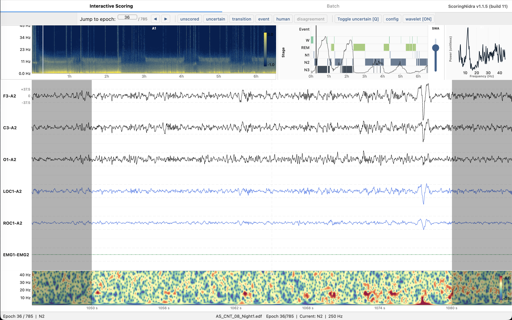

# Summary

Overnight polysomnography (PSG) is the reference method for studying sleep, yet turning a multi-hour, multi-channel recording into usable science involves several separate steps: visually scoring 30-second epochs into stages [@aasm2023], annotating events, running automated stagers, and quantifying spectral, microstructural and respiratory measures. CCS Sleep Studio is a standalone desktop application for macOS, Windows and Linux that brings these steps into one tool. It has three modules. *ScoringNidra* is an interactive viewer and editor for scoring and event annotation. *AutoscoreNidra* runs nine automated staging models, with multi-montage consensus and optional sequence refinement [@yu2024sleepgpt]. *AnalyseNidra* is a high-throughput analysis engine, usable from the interface or as a command-line program, that produces per-recording and batch tables together with a PDF report. The application reads EDF/EDF+ [@kemp1992; @kemp2003] and several vendor formats (Brain Products, Nihon Kohden, EMBLA, Orbit). It is built with Flutter for the interface and Rust for all numerical work. Users need no Python or MATLAB installation, and the staging models run locally, so recordings never leave the workstation.

{width=100%}

# Statement of need

Sleep laboratories and research groups, particularly those in clinical neurophysiology departments, usually need to combine manual scoring, automated staging and downstream quantification on the same recordings. Open tools exist for each part, but they sit in different ecosystems: Python libraries that must be installed and scripted, MATLAB toolboxes, a command-line toolkit, and commercial clinical suites. Where users are clinicians or students rather than programmers, maintaining a working scientific Python environment on shared or locked-down workstations is a recurring barrier. Performance is a second problem. Whole-night recordings can exceed 8 hours at several hundred hertz across tens of channels, and interpreter-based viewers can become sluggish when filtering, re-scaling or recomputing spectrograms. Finally, many labs record with more than one acquisition system, so format handling is a practical need.

CCS Sleep Studio is aimed at sleep and consciousness researchers, clinical neurophysiologists and technologists who score and analyse PSG or sleep EEG, and at methodologists who need reproducible batch pipelines. Its design goal is that a single download supports the whole path from raw recording to a collated analysis table, with every automatic result stored beside, and never in place of, the human scoring.

# State of the field

Several mature open-source projects cover parts of this workflow. YASA [@vallat2021] provides automated staging, spindle and slow-wave detection and spectral analysis in Python, building on MNE-Python [@gramfort2013]. Wonambi [@wonambi], Visbrain [@combrisson2019] and ScoringHero [@scoringhero] offer Python-based scoring or visualisation interfaces. SleepEEGpy [@sleepeegpy] wraps MNE and YASA for sleep EEG analysis, and Luna [@luna] provides a command-line and graphical ecosystem that includes the POPS stager. Deep-learning stagers such as U-Sleep [@perslev2021], TinySleepNet [@supratak2020], SeqSleepNet [@phan2019], SleepTransformer [@phan2022], GSSC [@hanna2023] and Dreamento [@esfahani2023] are distributed mostly as research code. For sleep microstructure and respiratory or limb-movement scoring, the usual options are commercial systems or purpose-built scripts. NeuroLoopGain [@kemp2000] is a standalone analyser of slow-wave feedback gain.

CCS Sleep Studio does not replace these tools. It reuses their published algorithms and, where a reference implementation exists, tests against it. Its interface and sidecar scoring files are inspired by ScoringHero. We built a new application rather than extend an existing one because our main requirement was a different runtime architecture: a compiled, self-contained program with a native compute core and a natively rendered interface. That cannot be added incrementally to an interpreter-based GUI. The trade-off is a larger code base (about 23,000 lines of Rust and 45,000 lines of Dart) and the need to re-validate every re-implemented method, which the project handles through parity testing (below).

# Software design

The software has three layers. The first is a Flutter application (Dart) that handles the interface, keyboard-driven scoring, annotation, comparison and batch orchestration. The second is a Rust shared library, linked through a C interface and `dart:ffi`. It performs file parsing, zero-phase Chebyshev display filtering, Welch spectrograms and Morlet wavelet transforms, with results passed to Dart as typed buffers without copying. Heavy work runs in background Dart isolates so that scrolling stays responsive. The third layer is `analyse-nidra`, a Rust crate that offers both a library and a command-line program, parallelised with `rayon`. It implements spectral and aperiodic analysis (Welch periodograms; native Levenberg–Marquardt versions of FOOOF [@donoghue2020] and IRASA [@wen2016]), YASA-compatible spindle and slow-wave detection [@lacourse2019; @vallat2021], slow-oscillation/spindle coupling (modulation index, mean vector length [@canolty2006] and phase-locking value [@penny2008]), nonlinear complexity measures, sleep-cycle and stage-dynamics metrics, NeuroLoopGain, cyclic alternating pattern analysis [@terzano2001], AASM-based respiratory event scoring including hypoxic burden [@azarbarzin2019], periodic limb movement scoring under AASM and WASM rules [@ferri2016], and DBS/neurostimulator artefact removal. The pretrained staging models are bundled and executed locally through ONNX (`tract-onnx`).

{width=90%}

Key design decisions follow from the intended users. First, *display filters act only on the visible window* plus a margin of real signal, which makes filter changes instantaneous on long recordings and removes edge transients. The full-night spectrogram is optional and off by default. Second, *provenance is explicit*: automatic scorings are saved as `<recording>_<algorithm>_scoring.json` and linked to the recording, so manual scorings are never overwritten, and several scorings can be compared with Cohen's kappa [@cohen1960], confusion matrices and per-stage F1. Third, *batch work is a linked pipeline* of autoscoring, preprocessing, feature extraction and master-sheet compilation. Each step can be run alone, and a resume mode reuses existing outputs. Fourth, *every analysis can be selected or skipped*, so exported tables only contain what was requested. Consensus staging scores each channel and valid reference combination independently and averages the epoch-wise probabilities, which reduces dependence on any single montage.

**Verification.** Because many methods are re-implementations, correctness is established mainly by comparison with reference code on real data. The repository holds reference fixtures and parity harnesses; \autoref{tab:parity} summarises the checks recorded during development. The repository also contains 87 Rust unit tests and 74 Dart unit and widget tests (counted by static search of the test annotations), and the continuous-integration workflow builds installers for macOS, Windows and Linux after running static analysis and the Flutter tests. A written release procedure requires `cargo test`, `flutter analyze` and `flutter test` to pass before each release.

| Component | Reference | Result |
|:---|:---|:---|
| Spindle detection | YASA | 3,508 events; all sample boundaries identical (one PSG night) |
| Slow-wave detection | YASA | 4,356 events; all sample boundaries identical |
| Modulation index | TensorPAC | maximum error below $2\times10^{-17}$ |
| NeuroLoopGain | NeuroLoopGain 2.x (C#) | 144 of 144 runs bit-identical (14 traces; 4 nights, 6 channels, 3 bands, 2 smoother rates) |
| Sleep cycles, stage dynamics | MATLAB code (run in Octave) | value-for-value on 4 nights and 900 synthetic hypnograms |
| Stimulation-artefact removal | Python implementation | correlation $\geq$ 0.998; $\leq$ 0.5 µV RMS difference (3.3 h DBS recording) |
| FOOOF band averages | SciPy-based FOOOF | within about 0.002; individual peak parameters can differ at local optima |
| Run time, one PSG night | Python spectral analysis | 30.6 s (Rust, complete regional pipeline) versus 194.1 s (Python, spectral stage only) |
| Apnea scoring | Annotated apneas, 4 OSA nights | sensitivity 0.35–0.91, PPV 0.69–0.91 (partial reference: apneas only) |
| PLM scoring | Clinical report, 1 recording | 494 PLMs versus 510 reported |

: Agreement of re-implemented components with reference implementations. The apnea and PLM rows are limited checks against partial references and are not clinical validation. \label{tab:parity}

# Research impact statement

CCS Sleep Studio has been developed and used within the Centre for Consciousness Studies at NIMHANS for scoring, autoscoring and feature extraction on PSG and sleep EEG recordings, and its development and testing have used recordings with deep-brain-stimulation artefact and clinical OSA and PLM studies. The repository provides a four-night demonstration dataset with matching manual scorings (`SamplePSGData`) that supports the parity checks above and lets new users reproduce the viewer, comparison, batch and reporting workflows. The project is under continuous development, with 34 tagged releases and a documented changelog, and pre-built installers (eight packages, full and lite editions, for macOS, Windows and Linux) are published through GitHub Releases.

[TO BE COMPLETED BEFORE SUBMISSION: JOSS requires evidence of research use. Add concrete, verifiable items, for example peer-reviewed or preprint papers, theses or grants whose data were scored or analysed with the software; use by named external groups; release download counts; and issues or pull requests from outside the core team. Remove this paragraph once done.]

# AI usage disclosure

Generative AI was used in developing this software and this manuscript. Anthropic's Claude, accessed through Claude Code and claude.ai, assisted with parts of the code base (including ports and refinements in the Rust analysis engine and features of the Flutter interface), with test writing, with documentation and changelog entries, and with drafting and editing this paper. [Authors to confirm the exact model names and versions, and the modules where AI-assisted code was accepted.] The authors specified the scientific requirements, chose the algorithms and architecture, reviewed all AI-assisted changes, and validated numerical behaviour against the reference implementations listed above. The authors take full responsibility for the accuracy, originality, licensing and ethical compliance of the submitted work.

# Acknowledgements

We thank the authors of ScoringHero, YASA, MNE-Python, NeuroLoopGain, SleepGPT, Luna, FOOOF/specparam and the other open-source projects that CCS Sleep Studio builds on or is validated against. [Funding sources and grant numbers to be added.] The authors declare [no competing interests / to be completed].

# References
